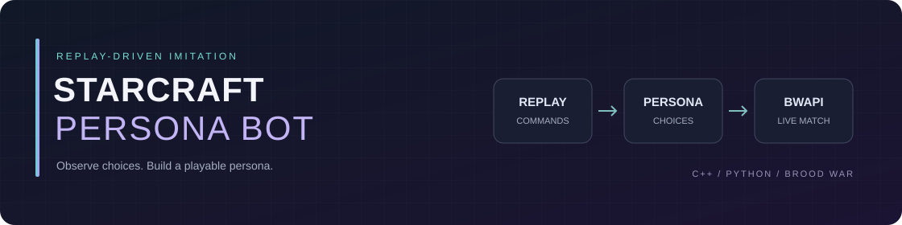
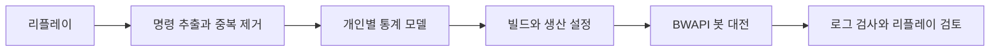

<div align="center">



# StarCraft Persona Bot

**리플레이에 남은 선택을, 다시 상대할 수 있는 봇으로.**


[](https://github.com/Cocode96/starcraft-persona-bot/actions/workflows/checks.yml)

[경기 보기](#경기-보기) / [작동 방식](#개인별로-반영한-것) / [검증 결과](#로컬-검증-결과) / [환경 준비](#준비와-학습)

</div>

스타크래프트 리플레이에서 개인별 선택을 추출하고, 직접 상대할 수 있는 BWAPI 봇에 반영한다. 목표는 Lavaa와 함께 게임하는 사람들의 빌드 선택과 운영 습관을 재현하는 것이다. 구현과 평가는 개인별 선택과 행동의 유사성을 기준으로 한다.

현재 버전은 저그, 테란, 프로토스의 생산 명령 비율과 실제 경기의 빌드 순서를 사용하는 통계적 모방 모델이다. 신경망이나 자가 대전 리그 학습은 사용하지 않는다. 별도 브루드워 1.16.1 환경에서 Lavaa와 Doran_e의 실제 봇 대전과 리플레이 저장을 확인했다. 사람이 알아볼 정도의 개인 플레이 재현은 아직 검증하지 않았다.

## 현재 상태

| 영역 | 구현과 확인 범위 |
| --- | --- |
| 리플레이 분석 | 원본 431개에서 중복을 제외한 424경기 분석, 파싱 오류 0건 |
| 개인별 모델 | 7명의 주 종족별 통계 모델, 상대 종족과 시간 구간별 생산 입력 분포 |
| 실제 실행 | Lavaa(Zerg)와 Doran_e(Protoss)의 BWAPI 대전, 경기 로그와 리플레이 저장 |
| 검증 | Python 테스트 41개, C++/DLL 검사 6개 통과한 로컬 검증 기록 |
| 진행 중 | 상황에 맞는 전략 전환, 방어와 템플러 보호, 사람이 알아볼 정도의 유사성 평가 |



> 모델은 리플레이의 입력 명령을 바탕으로 한다. 현재 대전 결과가 자동으로 모델에 되먹임되는 자가 학습 구조는 아니다.

## 경기 보기

**이미 데이터와 실행 환경을 준비한 로컬 PC**에서는 이 프로젝트 폴더에서 `watch-match.cmd`를 실행하면 Lavaa와 Doran_e가 투혼 1.3에서 대전한다. 두 창은 서로 다른 게임 폴더와 설정을 사용한다. 이미 StarCraft가 실행 중이면 중복 실행을 막는다. 끝난 경기는 `watch-last-replay.cmd`로 다시 열 수 있다. 시작 카메라는 한쪽 본진을 비추며 미니맵을 눌러 관람 위치를 바꿀 수 있다.

> 처음 복제했다면 아래 [준비와 학습](#준비와-학습)부터 진행한다. 개인 데이터, 생성된 모델과 게임 실행 파일은 저장소에 포함되지 않는다.

```powershell
python scripts/watch_match.py --left Lavaa --right Doran_e
python scripts/watch_replay.py
```

<details>
<summary><strong>실행 옵션, 반복 검증과 리플레이 진단</strong></summary>

```powershell
python scripts/watch_match.py --left Lavaa --right Doran_e
python scripts/watch_match.py --left Lavaa --right Doran_e --seed 1
python scripts/watch_match.py --prepare-only
python scripts/watch_match.py --fast-test --speed 0 --max-frames 24000
python scripts/watch_match.py --fast-test --speed 0 --max-frames 24000 --seed 1 --game-seed 1791839901
python scripts/audit_match.py
python scripts/watch_replay.py
python scripts/watch_replay.py --analyze --max-frames 24000
```

테스트 모드는 화면 렌더링을 끄고 지정 프레임에 게임을 종료한다. 프레임 제한으로 끝난 경기는 실력이나 승률 평가에 쓰지 않는다. 일반 관람은 프레임당 42ms 설정이다. 실행 폴더, DLL 해시, 프로세스 ID는 `dist/last-match.json`, 실제 실행 로그와 리플레이는 각 `dist/matches/<실행시각>/`에 남는다. 준비 기록은 `dist/last-prepared-match.json`에 별도로 저장하므로 `--prepare-only`가 마지막 실제 경기의 관람과 검사 대상을 바꾸지 않는다.

`--seed`는 개인 빌드와 유닛 선택용이다. 테스트에서 게임 난수도 고정하려면 별도의 `--game-seed`를 지정한다. 호스트의 BWAPI `seed_override`에 전달하고 실행 기록에 남긴다. 생략하면 기존처럼 게임의 시간 기반 난수를 사용한다. 실제 초기 난수는 경기와 리플레이 모두 `bwapi-data/write/game-seed.txt`에 기록한다. 과거 저장 경기의 값을 읽어 0~4294967295 범위에서 다시 지정할 수 있다. 같은 난수만으로 DLL 변경 후 교전 결과까지 동일하다고 가정하지 않는다.

리플레이의 `--analyze` 옵션은 저장된 봇 경기를 빠르게 재생하며 템플러의 연구, 에너지와 보이는 적까지 거리를 240프레임마다 기록한다. 실행 폴더와 원본 리플레이/DLL 해시는 `dist/last-replay-viewer.json`에 남는다. 일반 관람과 진단 재생 모두 유닛 명령을 발행하지 않는다. 연구용 1.16.1에서 저장한 경기로 검증했으며 리마스터 리플레이의 호환성은 확인하지 않았다.

`watch_match.py`는 고정 SHA-256으로 검증한 연구용 BWAPI 4.4.0 게임 배포본을 `tools/runtime/`에 준비한다. 기존 리마스터 설치와 원본 리플레이를 수정하지 않는다. 게임 데이터는 Git에서 제외한다. 배포 근거는 [SSCAIT 튜토리얼](https://sscaitournament.com/index.php?action=tutorial)과 [BWAPI 유지관리자 설명](https://github.com/bwapi/bwapi/discussions/892)이다.

대전과 리플레이 실행 폴더의 고정 게임 자료 4개(`STARDAT.MPQ`, `BROODAT.MPQ`, `StarCraft.mpq`, `patch_rt.mpq`)는 가능하면 하드 링크로 공유한다. 설정, DLL, 로그와 리플레이는 독립 파일로 유지한다. 하드 링크를 지원하지 않거나 다른 볼륨이면 복사한다. 08:19 실행 준비 중 공간 부족이 발생해 게임 시작 전에 중단됐다. 기존 테스트 폴더의 동일한 MPQ 227개를 SHA-256 대조 후 하드 링크로 바꾸어 약 5.2GB를 확보했으며, 원본 리플레이와 경기 증거는 보존했다.

공유 자료를 사용한 08:21 실제 대전과 `dist/replay-viewers/20261013-082925-408652`의 저장 경기 재생을 확인했다. 후자는 1,001프레임 제한 종료이며 원본 리플레이 해시와 초기 난수가 일치하고 유닛 명령 로그가 생성되지 않았다. 전체 리플레이 재생 완료 검증은 아니다.

</details>

## 개인별로 반영한 것

- 상대 종족과 경기 시간 구간별 유닛 생산 명령 비율. 각 경기에 같은 가중치를 주고, 상대 종족 표본이 3경기 미만이면 해당 사람의 전체 경기로 보완한다.
- 학습에 사용한 한 경기의 건설, 연구와 첫 업그레이드 명령 순서. 여러 경기의 건설 시점 중앙값을 섞지 않는다. 최대 96개 명령을 사용한다.
- 초반 일꾼 생산 명령 수로 추정한 일꾼 목표와 본진에서 먼 곳을 대상으로 한 첫 공격 명령 시점.

채취, 보급 관리, 건설 위치 선정, 정찰, 방어와 유닛 컨트롤은 공통 규칙이다. 봇은 실제 자원과 생산 가능 여부를 확인하므로 리플레이 입력 시각과 실행 시각은 달라질 수 있다. 경기마다 새 빌드를 고르려면 내보내기의 `--seed`를 바꾼다. 동일한 패키지는 같은 빌드와 난수 시드로 시작한다.

위 설명은 기존 `train-roster`의 schema 2 모델에 해당한다. 현재 관람 실행기는 schema 3 배포 모델을 별도로 만든다. 90일이 넘는 공백 이후를 최근 활동 구간으로 나누고, 같은 상대 종족과 맵 계열을 우선한다. 해당 맵이 없으면 같은 최근 구간의 같은 상대 종족으로 보완하며 사용한 원본 경기와 보완 이유를 `persona.context.json`에 남긴다. 최근성 가중치는 30일 반감기이며, 시간이 흐를수록 실력이 좋아진다고 가정하지 않는다. 최근 구간에 없는 상대 종족은 옛 빌드로 조용히 대체하지 않고 오류로 알린다.

초반 생산과 건설의 명령 순서를 함께 실행한다. 프로토스와 테란의 생산 버튼 반복 입력은 선택한 생산 건물과 유닛 생산 시간으로 줄여서 사용한다. 이 결과도 성공한 생산 수량을 복원한 값은 아니다. 생산 대기열, 취소와 자원 부족을 완전히 복원하지 못한다. 최근 배포에는 평가용으로 남겼던 최신 경기도 사용하므로 기존 분할 평가 점수를 최근 배포 모델의 성능으로 제시하지 않는다.

최근 배포의 빌드는 후보 경기마다 최근성 가중치를 주어 원본 경기 하나를 뽑는다. 같은 선택을 여러 경기에서 했다면 그만큼 후보에 자주 포함되며, 서로 다른 경기의 건설 시점을 섞지 않는다. 후보별 확률과 선택 시드는 `persona.context.json`에 기록한다. 기본 시드는 42이며 `watch_match.py --seed 1`처럼 바꾸면 다른 관찰 빌드를 선택할 수 있다. 데이터와 시드가 같으면 같은 결과를 재현한다. 빌드 이름이나 실제 드론 수는 명령만으로 단정하지 않는다.

투혼 포지 더블의 초기 건물 배치는 같은 사람, 같은 시작 위치에서 관찰한 좌표를 사용한다. 시작 위치별 출처는 `placements.context.json`에 남으며, 오래된 좌표를 사용하는 경우도 있다. 다른 시작 위치로 회전시켜 복사하지 않는다. 지형 검사는 하지만 버전 간 차이와 링 통과 틈은 추가 검증이 필요하다.

공통 실행 규칙에는 건설 일꾼 단일 배정, 미네랄 지역에 기반한 앞마당 탐색, 생산용 해처리, 파이런 이후 프로브 정찰, 랠리, 불리한 국지 교전에서 후퇴와 재집결, 템플러 후방 유지와 스톰 중복 억제가 있다. 이것을 개인의 컨트롤을 학습한 결과라고 부르지 않는다. 화면에 보이는 적과 이전에 확인한 위치만 사용한다.

## 로컬 검증 결과

**확인 기준일: 2026-10-13**

| 실제 경기에서 확인한 것 | 해석 범위 |
| --- | --- |
| 양쪽 앞마당 생성, 정찰/랠리, 건설 일꾼 중복 방지 | 기본 운영 검사이며 링을 완전히 막는 심시티 판정은 아님 |
| 저그 7해처리 규모, 후반 공급 포화 0/65표본 | 마지막 풀 선행 경기의 관찰 결과, 모든 빌드의 개선을 보장하지 않음 |
| 가스 과잉 시 미네랄 전환과 가스 채취 재개 | 공통 실행 규칙의 실제 동작, 개인 채취 습관 학습은 아님 |
| 토스 스톰 연구 완료와 시전 명령 18회 접수 | 마지막 경기 기준, 적중 피해와 템플러 호위 효과는 미측정 |


<details>
<summary><strong>리플레이 표본과 과거 평가</strong></summary>

2026-10-12 기준 원본 431개를 읽고 바이트 중복 6개와 저장 형태가 다른 동일 경기 1개를 제외해 424경기를 분석했다. 파싱 오류는 없었다. 원본은 수정하지 않았다.

사람 두 명이 서로 다른 팀으로 참여한 1,440프레임 이상 경기를 종족별로 분류했다. 다음 표는 기존 schema 2의 시간순 분할 평가다. 각 사람의 가장 많이 플레이한 종족을 선택하고 최근 약 20%를 평가용으로 남겼다. 이 과거 평가 모델에는 평가 경기의 입력이 포함되지 않는다. schema 3 최근 배포와는 별개다.

| 리플레이 닉네임 | 종족 | 학습 경기 | 평가 경기 |
| --- | --- | ---: | ---: |
| Lavaa | Zerg | 141 | 35 |
| Doran_e | Protoss | 91 | 22 |
| dnfla9407 | Protoss | 84 | 20 |
| Flash_Bangg | Terran | 61 | 15 |
| sdh321654 | Terran | 37 | 9 |
| 9666 | Protoss | 16 | 3 |
| kkami77777 | Zerg | 36 | 9 |

평가는 지원하는 유닛의 생산 명령 예측 정확도와 음의 로그 가능도를 측정한다. 비교 대상은 같은 종족의 여러 사람을 합친 모델이며, 평가 경기와 평가 시작 시점 이후의 경기를 제외한다. 개인 모델이 항상 비교 모델보다 낫지는 않았다. 이 지표는 승률이나 사람과 닮은 정도를 뜻하지 않는다. 상세 수치와 분할 경기 ID는 로컬 `data/roster/*/model.json`의 `evaluation`에 있다.

</details>

Python 테스트 41개, Windows x86 DLL 빌드, C++ 설정/전투 판단/공급 관리/생산능력/채취 균형/DLL 로드 테스트 6개를 통과했다. 기존 28개 INI와 실행마다 생성한 schema 3 설정의 BWAPI 타입과 종족도 검사한다. 최근 후보 5개(Lavaa 3개, Doran_e 2개)의 내보내기 설정도 검사했다. 이 검사는 실제 게임 검증을 대체하지 않는다.

<details>
<summary><strong>최근 경기 시간순 평가와 실험 후보</strong></summary>

최근 모델은 다음 명령으로 시간순 평가할 수 있다. 평가할 경기보다 시작 시각이 엄격하게 이른 경기만 학습에 넣고, 같은 시각과 이후의 경기, 상대 선수 기록을 포함한 원본 전체에서 미래 데이터를 제외한다. 현재 활동 구간의 같은 상대 종족 선행 경기가 최소 2개일 때 평가하며, 원본 경기 ID와 생략 이유를 로컬 JSON에 남긴다. 생산 버튼 반복 입력을 같은 방식으로 정리한 과거 개인 모델과 비교하고 경기별 점수를 같은 비중으로 평균한다.

```powershell
python -m persona.evaluate_current Lavaa --race Zerg --opponent Protoss --output data/evaluation-current/Lavaa-vs-Protoss.json
python -m persona.evaluate_current Doran_e --race Protoss --opponent Zerg --output data/evaluation-current/Doran_e-vs-Zerg.json
python -m persona.evaluate_current Doran_e --race Protoss --opponent Zerg --policy-prior-games 1 --output data/evaluation-current/Doran_e-vs-Zerg.candidate.json
```

10월 13일 추가 평가에서는 Lavaa 저프전 1경기(전투 명령 24개), Doran_e 저그전 4경기(전투 명령 220개)만 평가 가능했다. 희소한 시간대에서 이미 관찰된 선택이 확률 0이 되는 문제를 줄이려고, 같은 사람의 최근 같은 상대 종족 전체 시간대 분포를 1경기 분량으로 보완하는 후보를 실험했다. 새 유닛이나 다른 사람의 선택을 만들어 넣지는 않는다. 후보의 Doran_e 전투 명령 정확도는 경기 평균 64.9%에서 68.1%로 변했지만, 일꾼 포함 정확도는 61.3%에서 51.1%로 떨어졌다. Lavaa 전투 정확도는 95.8%로 같았지만 음의 로그 가능도는 0.323에서 0.431로 나빠졌다. 이 점수는 생산 입력 예측이며 승률이나 개인 유사성이 아니다. 같은 평가 자료를 보고 설계한 후보이므로 독립적인 최종 성능 검증으로 제시하지 않는다.

따라서 후보는 기본 봇에 적용하지 않았다. `--policy-prior-games` 기본값은 0이고 관람 실행기는 이 기본값을 쓴다. 실험값 1은 평가 또는 `persona.temporal` 내보내기에서 명시적으로 선택해야 한다. 후보를 포함한 INI 4개가 BWAPI 계약 검사를 통과했고, 기본 INI는 두 사람과 시드 1/5/9/42의 8조합에서 이전 커밋과 바이트 단위로 일치했다. 이번 변경은 분석/실험 경로이며 새 DLL이나 실제 경기 결과를 추가한 것은 아니다. 평가와 후보 모델은 `data/evaluation-current/`에만 저장한다.

</details>

<details>
<summary><strong>실제 대전 기록과 실행 규칙 — 2026-10-13</strong></summary>

2026-10-13 현재 실제 경기 검증 기록:

| 실행 폴더 시각 | 확인한 결과 | 남은 문제 |
| --- | --- | --- |
| `20261012-234751-906233` | 투혼 1.3, 18,000프레임 제한. 양쪽 앞마당 생성, 정찰과 랠리, 초반 시간 초과 0회 | 후반 생산 정체와 무리한 진출 발견 |
| `20261012-235517-984393` | 투혼 1.3, 20,710프레임에 대전 종료와 리플레이 저장. 럴커 생산, 후퇴/재집결, 템플러 스톰 입력 확인 | 토스의 막힌 건설 위치 반복 시도로 후속 생산 건물 지연. 다음 수정에서 위치 재탐색 추가 |
| `20261013-000320-693205` | 투혼 1.3, 24,000프레임 제한. 양쪽 앞마당, 정찰, 랠리, 일꾼 중복과 자원 정체 검사 통과. 초반 시간 초과 0회, 리플레이 저장 | 제한 종료이므로 승패 평가 제외. 다른 시작 위치와 맵의 반복 검증 필요 |
| `20261013-010632-958336` | 투혼 1.3, 24,000프레임 제한. 양쪽 종료 콜백의 `test_limit` 확인, 기본 운영 검사 통과. 초반 시간 초과와 일꾼 중복 0회. 리플레이 저장 | 토스 스톰 실행 기록 없음. 후속 리플레이 진단에서 연구가 시작되지 않은 것을 확인 |
| `20261013-021025-364659` | 연구 자원 확보 수정 후 시드 42, 이전과 서로 바뀐 시작 위치. 21,454프레임에 경기 종료. 양쪽 기본 운영 검사 통과. 스톰 연구 12,900프레임 시작, 14,880프레임 완료 최초 관찰, 스톰 명령 12회 접수 | 적중 피해, 템플러 호위 품질과 개인 유사성은 미평가. 이 한 경기의 승패를 성능 지표로 사용하지 않음 |
| `20261013-031104-404868` | 시드 5의 풀 선행 빌드, 저그 북서/토스 북동 시작. 풀 2,149프레임, 저그 앞마당 3,672프레임, 토스 앞마당 3,369프레임에 생성. 16,866프레임에 경기 종료와 리플레이 저장. 양쪽 기본 운영 검사 통과, 초반 시간 초과와 일꾼 중복 0회 | 스톰 연구는 13,008프레임 시작했으나 첫 템플러 2기가 연구 중 사망. 후속 1기도 에너지 부족 상태에서 사망하여 스톰 명령 0회. 템플러 생존과 병력 보호 추가 점검 필요 |
| `20261013-041116-878096` | 템플러 이동 수정 후 시드 5, 저그 북서/토스 남서. 24,000프레임 상한에서 17,610프레임에 경기 종료와 리플레이 저장. 양쪽 기본 운영 검사 통과. 스톰 연구 12,714프레임 시작, 14,640프레임 완료 최초 관찰. 스톰 5회와 회피 이동 95회 명령 접수 | 이전과 시작 위치가 달라 효과 크기 비교는 불가. 템플러의 가장자리 고립과 재합류, 본대 전투 손실은 남음. 스톰 피해와 개인 유사성 미평가 |
| `20261013-051523-939006` | 시드 1의 양쪽 다른 후보 빌드, 저그 북동/토스 남동. 17,021프레임에 종료. 양쪽 앞마당과 초반 명령 실행 확인 | 토스 자원 정체 검사 실패. 파이런 건설 지연 중 생산을 매번 중단하고 본진 주변 위치를 반복하는 문제 발견. 템플러 미등장으로 이동 수정의 실전 검증에는 사용하지 않음 |
| `20261013-052200-050087` | 생산 중단과 파이런 위치 수정 후 시드 1. 16,463프레임 종료, 양쪽 기본 운영 검사 통과. 본진 파이런 시도 만료 후 앞마당 쪽 (30,103)에 12,533프레임 생성. 템플러 경로 기록 83건, 검사 규칙 위반 0건 | 교전 회피 명령은 없어 일반 복귀 경로만 검증. 경기 말미 공급 대기와 자원 축적은 남아 있으며 장시간 정체 기준에 도달하기 전에 종료됨. 원본 빌드에 스톰 연구 입력 없음 |
| `20261013-052729-164590` | 최종 수정 DLL, 시드 5. 16,432프레임 종료와 리플레이 저장. 양쪽 기본 운영 검사 통과. 템플러 일반 이동 11회, 회피 47회, 이전 이동 취소 11회 접수. 경로 기록 69건의 검사 규칙 위반 0건, 스톰 2회 접수 | 직선 후보 경로 검사이며 엔진 우회와 적 추격에 대한 생존 보장은 아님. 본대 손실과 템플러 사망이 남아 재합류 품질이나 개인 유사성 개선으로 판정하지 않음 |
| `20261013-061800-985827` | 시드 1, 24,000프레임 제한 종료와 리플레이 저장. 초반 시간 초과와 일꾼 중복 0회, 양쪽 앞마당 확인. 토스 후반 공급 포화 7/74표본, 최대 연속 3표본. 건설 중 공급을 포함해 파이런 선행 요청 확인 | 저그 기본 운영 검사 통과, 토스는 미네랄 2,500 이상 지속 경고가 남음. 해당 구간 게이트 5개가 생산 중인 것을 확인해 공급 차단과 구분. 생산시설 규모와 자원 소비 균형은 미해결 |
| `20261013-071454-757704` | 게이트 보충 수정 후 시드 1, 저그 남동/토스 북서. 14,913프레임 종료와 리플레이 저장. 양쪽 앞마당과 기본 운영 검사 통과, 초반 시간 초과와 일꾼 중복 0회 | 게이트 보충 조건까지 도달하지 않아 해당 동작은 미검증. 토스 후반 공급 포화 20/37표본과 저그 일꾼 손실이 남음. 단순 검사 통과를 전투 품질로 해석하지 않음 |
| `20261013-072021-362013` | 같은 DLL과 시드 1, 저그 북서/토스 북동. 14,851프레임 종료와 리플레이 저장. 양쪽 앞마당과 기본 운영 검사 통과, 초반 시간 초과와 일꾼 중복 0회 | 게이트 보충 요청 없음. 저그는 약 8,500프레임부터 앞마당 주변 병력 손실 뒤 일꾼 피해가 이어짐. 해처리 선행 빌드의 초기 방어는 별도 수정과 검증 필요 |
| `20261013-072509-947147` | 시드 9로 저그 풀 선행/토스 기존 5게이트 원본 조합, 저그 북동/토스 남동. 22,012프레임 종료와 리플레이 저장. 양쪽 기본 운영 검사 통과, 템플러 이동 경로 689건의 규칙 위반 0건 | 토스의 자원이 부족하고 생산시설이 파괴되어 추가 게이트 요청 없음. 자원 축적 시 보충 동작은 이 경기로 검증하지 않음. 양쪽 공급 대기와 전투 손실은 남음 |
| `20261013-073225-982893` | 시드 1, 저그 남서/토스 북서. 15,099프레임 종료와 리플레이 저장. 양쪽 앞마당과 기본 운영 검사 통과 | 저그 초기 방어 손실 재관찰. 토스는 경기 말미 자원이 남았지만 파이런 건설 작업 중이어서 추가 게이트 요청 없음. 후반 보충 동작 검증에는 사용하지 않음 |
| `20261013-073814-338193` | 빌드 시드 1, 게임 난수 123456789, 저그 북서/토스 남서. 호스트 난수 설정과 실행 기록 확인, 15,006프레임 종료와 리플레이 저장. 양쪽 기본 운영 검사 통과 | 추가 게이트 조건 전에 종료. 앞선 무작위 시작 경기와 동일 조건 비교가 아니며, 저그 초기 방어 한계가 다시 관찰됨 |
| `20261013-074518-391561` | 빌드 시드 1, 게임 난수 42. 직전 1,000프레임 배치 확인 실행 `074326-700331`과 같은 저그 북서/토스 남동 시작. 15,254프레임 종료와 리플레이 저장, 양쪽 기본 운영 검사 통과 | 시작 배치 재현만 확인했으며 게이트 보충 조건 전에 종료. 짧은 배치 확인 실행은 기본 운영 검사에 포함하지 않음 |
| `20261013-075208-073710` | 06:18 리플레이에서 복원한 게임 난수 1791839901, 빌드 시드 1. 같은 저그 북동/토스 남서 배치와 양쪽 실제 초기 난수 확인. 24,001프레임 제한 종료와 리플레이 저장, 양쪽 기본 운영 검사 통과. 게이트 4개 추가 생성과 완성 후 생산 관찰, 작동 게이트 5개에서 9개로 증가. 토스 미네랄 최고 표본 1,698로 기존 2,500 이상 지속 경고 미발생 | 같은 시작 조건이지만 교전 전개는 달라 효과 크기나 실력 향상으로 일반화하지 않음. 저그 가스 축적과 공급 대기, 다른 시작 위치의 초기 방어 문제가 남음. 템플러는 원본 빌드에 스톰 연구 입력이 없어 이번에도 연구하지 않음 |
| `20261013-082113-696909` | 저그 채취 균형 수정 후 빌드 시드 1, 게임 난수 1791839901. 24,001프레임 제한 종료와 리플레이 저장, 양쪽 기본 운영 검사 통과. 저그 가스 최고 표본 1,228, 마지막 505. 미네랄 전환 18회 접수, 최소 간격 96프레임. 가스 배정 0명까지 감소한 뒤 18,960프레임 표본에서 가스 496과 9명 배정으로 재개 확인. 토스 추가 게이트 3개 생성과 생산도 확인 | 이전 같은 시작 조건의 저그 마지막 가스 4,653과 차이가 있지만 교전 전개와 유닛 생산도 달라 통제된 성능 개선율이 아님. 저그 공급 포화 15/74표본과 다른 시작 위치의 초기 방어 문제는 남음. 개인 채취 성향 학습으로 간주하지 않음 |
| `20261013-083230-605776` | 저그 공급 여유 수정 후 빌드 시드 1, 게임 난수 1791839901. 저그 22,198프레임 패배, 토스 22,229프레임 승리와 리플레이 저장. 양쪽 앞마당과 기본 운영 검사 통과, 초반 시간 초과와 일꾼 중복 0회. 6,846프레임 사용/완성 공급 44/52에서 오버로드 요청, 9,246프레임에는 여유 목표 16 적용 | 저그 공급 포화 5/60표본이지만 중반부터 병력과 일꾼을 잃고 오버로드 9기도 파괴됨. 이전 15/74표본보다 적다는 이유로 공급 개선이나 실력 향상을 주장하지 않음. 최대 규모의 해처리 생산력 검증은 부족함 |
| `20261013-083938-058749` | 빌드 시드 5의 풀 선행 저그/스톰 연구 포함 토스, 게임 난수 1791839901. 저그 21,671프레임 승리, 토스 21,640프레임 패배와 리플레이 저장. 양쪽 기본 운영 검사 통과. 저그 7해처리 규모에서 공급 여유 28과 변태 중 공급 16을 함께 반영한 추가 요청 확인, 후반 공급 포화 0/65표본. 마지막 저그 일꾼 33, 병력 93. 토스 스톰 연구 완료 최초 관찰 15,120프레임, 시전 명령 18회 접수, 템플러 이동 경로 410건의 검사 규칙 위반 0건 | 서로 다른 빌드 결과라 앞 경기와 승률이나 개선율을 비교하지 않음. 토스 후반 공급 포화 2/63표본과 방어 붕괴가 남음. 스톰 피해량, 템플러 생존 효과와 개인 플레이 유사성은 미측정. 저그 가스가 최고 436으로 채취 중단 조건에는 도달하지 않음 |

실행 기록이 없는 새 DLL의 수정은 이전 경기 결과로 검증됐다고 간주하지 않는다. `audit_match.py`는 실제 구조물 생성, 앞마당 좌표, 초반 시간 초과, 일꾼 중복 명령, 정찰/랠리와 자원 정체를 검사한다. 9,000프레임 이상 관찰하고 게임 종료 콜백의 결과 기록이 있어야 검사 통과로 표시한다. 누락된 로그와 진행 중인 경기는 검증 완료로 처리하지 않는다. 검사 통과가 링 완전 차단, 컨트롤 재현이나 개인 유사성을 뜻하지 않는다.

07:14~07:45 경기의 DLL SHA-256은 `20449138a89ffcce206e13042507aa2c275ce2e5c48392fdcd1a03ca8daf530e`다. 07:52 초기 난수 기록 추가 DLL은 `f3ad5536a6ca16de7d9c5de9d9b322d3e67b79d3fdbd4150da9033bad8d63615`, 08:21 저그 채취 균형 추가 DLL은 `099ff6d2645455ac10dfb4f75d6de8e733bda647a159d57a7cf7453000f94823`다. 08:32 이후 저그 공급 여유 추가 DLL은 `d2d01b00c377cf7845f9c8ae3f81859b2ba3eef67ae9de7fa76a7e1418d6cbb5`다. 실행별 원본 해시는 각 폴더의 `match.json`에 남긴다. `20261013-061709-814136`은 빌드 실패 뒤 이전 DLL로 열린 실행이라 조기 종료하고 검증에서 제외했다.

리플레이 진단 `dist/replay-viewers/20261013-075109-375382`에서는 06:18 경기의 처음만 재생해 BWAPI `getRandomSeed()`로 초기 난수 1791839901을 읽었다. 이 함수는 SDK 문서상 실제 경기와 리플레이의 초기 난수를 모두 지원한다. 이 진단은 전투나 생산 검증이 아닌 기존 실패 조건 복원에 사용했다.

리플레이 전용 시작 카메라를 추가한 DLL도 빌드와 CTest를 통과했다. `watch_replay.py`로 `20261013-000320-693205` 경기의 저장 파일을 다시 열어 본진 화면과 재생 시간 진행을 실제 창에서 확인했다. 리플레이 관람 중에는 생산과 전투 명령을 실행하지 않는다.

`dist/replay-viewers/20261013-020834-249930`에서는 `20261013-010632-958336` 경기의 24,000프레임까지 진단 재생을 완료했다. 템플러 상태 259건 중 스톰 연구 중/완료 상태는 0건이며 에너지 75 이상은 227건이다. 유닛 생산에 자원이 소모되어 예정된 연구를 시작하지 못하는 실행 문제를 확인했다. 기록된 연구 시점 이후, 연구 건물과 선행 조건이 갖춰졌다면 비용을 모아 연구부터 시작하도록 보완했다. 이것은 개인 성향 학습이 아닌 실행 수정이다.

`caster-state.tsv`와 `replay-casters.tsv`의 열은 프레임, 플레이어 ID, 유닛 ID, 에너지, 스톰 연구 완료, 연구 중, 보이는 적 유닛의 최소 거리(-1은 없음), 근처 적 밀집도의 보조 점수, 현재 명령 ID, X, Y 순서다. `research-actions.tsv`는 자원 저축과 연구 시작을 기록한다. `audit_match.py`의 `casters` 항목은 연구 완료 최초 관찰과 접수된 스톰 명령 수를 요약하며 적중 피해나 호위 품질을 판정하지 않는다.

템플러 이동은 480픽셀 안의 지상 전투 병력 뒤를 기준으로 한다. 연구나 에너지가 부족하면 더 뒤에 머물고, 위협이 가까우면 보이는 적의 기본 지상 사거리와 32픽셀 여유를 기준으로 이동 후보를 비교한다. 일반 복귀와 회피 모두 최대 320픽셀의 다음 지점으로 나누고 직선 경로를 약 32픽셀 간격으로 검사한다. 목적지가 안전해 보여도 중간 지점에서 적 사거리 안으로 더 들어가는 후보는 제외한다. 안전 여유가 있는 후보에는 병력 근접과 가장자리에서 떨어진 공간을 선호하는 작은 보정을 적용한다. 실제 엔진의 우회 경로와 적의 이동까지 보장하지 않으며 개인 컨트롤 학습은 아니다. `caster-moves.tsv`에는 프레임, 유닛 ID, 이동 종류, 주변 호위 수, 현재/목표 사거리 여유, 목표 X/Y를 남긴다. 최신 로그는 시작 X/Y와 경로의 최소 사거리 여유를 덧붙인다. 검사기는 일반 복귀를 포함한 경로 검사 수와 규칙 위반 수를 별도로 보고한다. 더 안전한 후보가 없으면 이전 이동을 취소하는 `hold`도 기록한다. 검사기의 회피 횟수는 접수된 명령 수이며 성공적인 회피나 생존 횟수가 아니다.

맵 계열 비교는 `(4)Polypoid1.75`처럼 인원 접두사와 붙어 있는 버전명을 정리한다. 실제 데이터 내보내기에서 최근 Polypoid 저프전 2개만 빌드 후보로 선택되고 다른 맵 보완이 발생하지 않는 것을 확인했다. 지형이 같은지 검증하는 기능은 아니다. `--prepare-only --seed 1` 실행 전후 마지막 경기 기록의 해시도 동일했다.

프로토스는 초반 명령 구간 이후 완성되고 전력이 공급된 생산시설 수에 따라 공급 여유를 확보한다. 목표는 BWAPI 반 칸 단위로 생산시설당 4, 넥서스당 2이며 8~48 범위다. 건설 중인 공급을 합산하고 총 200 공급에 도달할 예정이면 추가 요청하지 않는다. `supply-plans.tsv`의 열은 프레임, 사용 공급, 완성 공급, 건설 중 공급, 여유 목표다. 개인 빌드 선호를 새로 학습한 규칙은 아니다.

저그도 초반 명령 구간 이후 완성된 해처리/레어/하이브 수에 따라 공급 여유를 확보한다. BWAPI 반 칸 단위로 건물당 4, 최소 8, 최대 48이며 변태 중인 오버로드 공급을 기존 계산에 포함한다. 초반 원본 빌드 순서와 총 200 공급 제한은 유지한다. 공급을 미리 요청하는 공통 규칙이며 오버로드 생존이나 교전 판단을 해결하지는 않는다.

프로토스 후반 생산시설 보충도 공통 실행 규칙이다. 14,400프레임 이후 원본 빌드의 게이트 수를 충족하고, 작동 중인 게이트의 75% 이상이 생산 중이며 미네랄 1,200 이상과 공급 여유가 있을 때 하나씩 추가한다. 생산 가능한 개인 모델 유닛과 가스도 확인하며, 건설 중 게이트나 다른 건설 작업이 있으면 기다린다. 요청 간격은 최소 1,200프레임이며 작동 중인 게이트가 12개 이상이면 추가하지 않는다. `capacity-plans.tsv`는 프레임, 완성/생산 중 게이트 수, 미네랄, 공급 여유, 요청 좌표를 기록한다. 검사기의 `capacity` 항목은 요청과 실제 생성, 완성 후 생산 대기열 관찰을 구분한다. 유닛 생산 완료나 개인 빌드 유사성 판정은 아니다.

검사기의 `supply`는 6,000프레임 이후 일꾼이 남아 있고 총 공급이 200 미만인 상태에서 공급 포화를 집계한다. 240프레임 간격 표본이라 정확한 대기 시간을 뜻하지 않는다. 이전 `052200` 경기는 포화 23/43표본, 최대 연속 19표본이며 새 경기는 7/74표본, 최대 연속 3표본이었다. 시작 위치와 전투가 달라 이를 통제된 개선율로 해석하지 않는다.

후속 파이런 건설이 실패해도 남은 공급 안의 생산은 계속 시도한다. 본진 주변에서 파이런 건설이 만료되면 완성된 보유 기지 중 건물이 덜 몰린 곳에서 다음 위치를 찾는다. 초기 관찰 심시티는 이 우회 대상에서 제외한다.

후속 검증은 템플러 생존과 병력 보호, 다른 맵의 앞마당과 심시티, 후반 일꾼 수와 생산시설 수, 아직 실행하지 않은 후보 빌드를 우선한다. 투혼용 최근 후보는 Lavaa의 경우 같은 맵 표본이 없어 다른 맵의 저프전 3경기이며, Doran_e는 투혼 저그전 2경기다. 후보 확률은 이 제한된 표본의 빈도이며 평소 빌드 선호 확률이 정확하다는 의미는 아니다.

사용자가 답한 두 상황별 선택과 개인 성향 기억은 Git에서 제외한 `data/style-feedback.json`에 출처를 구분해 보관한다. 자동으로 학습된 정책이라고 표시하지 않는다. `python -m persona.micro Doran_e --replay-root <원본폴더>`는 스톰 전후 선택과 명령을 추출한다. 47경기에서 스톰 입력 939회를 찾았으나 실제 적중, 생존, 뮤탈 손실은 판정하지 않는다. 결과는 `data/caster-evidence.json`이다.

</details>

## 준비와 학습

| 작업 | 필요한 환경 |
| --- | --- |
| 분석과 모델 평가 | Python 3.11 이상, 로컬 리플레이 |
| 봇 DLL 빌드 | Windows, Visual Studio 2022 C++ 데스크톱 개발, CMake, BWAPI 4.4.0 |
| 실제 경기 | 별도 브루드워 1.16.1/BWAPI 환경, 생성된 개인별 패키지 |

저장소 루트에서 실행한다. `train-roster` 전에 로컬 `data/player-identities.json`을 아래 형식으로 준비한다. `nickname`에는 리플레이에 기록된 정확한 닉네임을 사용한다.

```json
{"players": [{"nickname": "ExactNickname", "display_name": "ConfirmedName"}]}
```

```powershell
python scripts/bootstrap.py --bwapi
python -m persona.cli scan "$env:USERPROFILE/Documents/StarCraft" --output data/replays-v2.json
python -m persona.cli players --input data/replays-v2.json --anchor Lavaa --limit 20
python -m persona.cli train-roster --seed 42
python -m unittest discover -s tests -v
python scripts/build_bot.py --roster data/roster
python scripts/select_persona.py
python scripts/select_persona.py Lavaa
```

`bootstrap.py`는 공식 릴리스의 고정 버전 screp v1.13.7과 BWAPI 4.4.0을 `tools/`에 준비하고 SHA-256을 대조한다. 분석과 통계 모델에는 외부 Python 패키지, GPU와 OpenAI API 키가 필요하지 않다. 설치된 게임을 수정하지 않는다.

`train-roster`는 위 파일에서 확인된 닉네임과 이름을 읽는다. Lavaa는 기본 포함된다. 인물 매핑, 개인 모델과 원본 리플레이는 Git에서 제외한다.

한 명만 처리할 수도 있다.

```powershell
python -m persona.cli train Lavaa --race Zerg --output data/Lavaa-model.json
python -m persona.cli export-model data/Lavaa-model.json --opponent Protoss --seed 42 --output data/Lavaa-vs-Protoss.ini
```

`scan`은 파일 SHA-256과 시작 시각, 맵, 참가자 정보로 중복을 묶는다. 같은 닉네임이라도 다른 문자열을 자동으로 같은 사람으로 합치지 않는다. 기존 `profile`과 `export-bot` 명령은 초기 저그 중앙값 프로필 호환용으로 남아 있다.

## 사람 선택과 실행 패키지

`dist/players/<닉네임>-<종족>/bwapi-data/`에 각 사람의 DLL과 설정 4개가 있다. DLL은 공통이고 개인별 모델 설정이 다르다. `select_persona.py`에 닉네임 또는 확인된 이름을 입력하면 `dist/bwapi-data/`에 선택한 패키지를 복사한다. 게임 설치나 실행은 하지 않는다.

모델은 기본 `persona.ini`와 상대 종족별 `persona-Zerg.ini`, `persona-Terran.ini`, `persona-Protoss.ini`로 구성된다. 게임 시작 시 BWAPI가 알려주는 상대 종족이 확정되어 있으면 해당 설정을 사용한다. 랜덤 또는 알 수 없는 상대는 기본 설정을 쓴다. 숨겨진 적 유닛 정보는 조회하지 않는다.

합법적으로 확보한 브루드워 1.16.1과 BWAPI 4.4.0 실행 환경이 준비되면 다음 순서로 검증한다.

1. 원하는 사람을 `select_persona.py`로 선택한다.
2. `dist/bwapi-data/`의 내용을 별도 1.16.1 게임 폴더의 `bwapi-data/`에 복사한다.
3. 해당 설치의 `bwapi-data/bwapi.ini`에서 `[ai]`의 `ai`를 `bwapi-data/AI/PersonaBot.dll`로 설정한다.
4. BWAPI가 활성화된 Chaoslauncher에서 실행하고 선택한 사람의 종족으로 설정한다.
5. 사람과 대전하려면 BWAPI가 활성화된 봇 인스턴스와 주입을 끈 사람 인스턴스로 Local PC 방에 입장한다.

화면에 닉네임과 학습 표본 수가 표시된다. 종족이나 모델 타입이 맞지 않으면 봇이 중지하고 이유를 출력한다. 설정이 없거나 파싱에 실패하면 명시적인 `Baseline Zerg` 규칙으로 돌아간다. 결과는 `bwapi-data/write/persona-results.txt`에 남긴다. 리마스터 설치에 DLL만 복사해서 실행할 수는 없다.

## 알려진 한계

저그 모방 설정의 초반 명령 구간 이후에는 가스 1,200 이상이고 미네랄의 두 배를 넘으면 가스 배정을 줄인다. 96프레임마다 화물을 들지 않은 일꾼 최대 1명을 완성된 보유 기지의 미네랄로 돌린다. 가스가 500 이하이거나 미네랄이 가스 이상이 되면 재개한다. 서로 다른 중단/재개 기준으로 반복 전환을 줄이는 공통 실행 규칙이며, 실제 개인의 가스 조절 타이밍을 학습한 것은 아니다. `gas-balance.tsv`는 프레임, 중단 상태, 미네랄, 가스, 가스 배정 수를 기록하고 `gas-transfers.tsv`는 접수된 전환 명령을 남긴다. 검사기는 자원 표본과 명령 수를 보고하며 완료된 채취량으로 해석하지 않는다.

리플레이는 성공한 행동이 아닌 입력 명령을 제공한다. 취소, 실패, 같은 위치의 재건설과 반복 업그레이드 레벨을 복원하지 않는다. 건물 명령 시각을 완성 시각으로 해석하면 안 된다. 공격 시점과 일꾼 목표는 추정값이다. UMS 관전 맵이 필터를 통과할 수 있고 맵 규칙은 별도 검토가 필요하다. 분석 결과에는 게임 채팅을 저장하지 않는다.

지원 유닛만 생산하고 아칸 합체, 수송과 드롭, 섬맵 이동과 일부 마법은 구현하지 않았다. 확장과 일꾼 배분, 전투력 추정은 공통 규칙이다. 생산 정책에 등장하는 유닛의 선행 건물과 기술을 보완하지만 하이브를 자동으로 선택하지는 않는다. 리플레이 명령 시간과 실제 상황이 다를 때의 전략 전환, 다방향 견제, 템플러 호위의 실제 효과는 추가 검증이 필요하다. 공통 실행 규칙이 개인 특성을 얼마나 바꾸는지도 아직 측정하지 않았다.

## 프로젝트 구조와 실행 환경

| 경로 | 역할 |
| --- | --- |
| `persona/` | 명령 추출, 통계 모델 학습, 분할 평가와 INI 내보내기 |
| `bot/` | BWAPI C++ 모듈과 모델 설정 해석 |
| `scripts/` | 도구 준비, DLL 빌드와 사람 선택 |
| `tests/` | 데이터 분할, 확률 선택, 설정 계약과 DLL 로드 검사 |
| `data/`, `dist/` | 로컬 개인 데이터와 실행 산출물, Git 제외 |

Visual Studio 솔루션은 `build/StarCraftPersonaBot.sln`이다. `persona/unit_types.json`은 BWAPI 4.4.0 정적 타입 정보이며 빌드된 `unit_catalog.exe`로 다시 생성할 수 있다.

실제 경기 실행과 DLL 빌드는 로컬 Windows 환경에서 진행한다. Codex Cloud에서는 이 저장소의 리플레이 분석 코드와 테스트를 작업할 수 있다. 클라우드 환경의 저장소로 이 프로젝트를 선택하고 Python 3.11 이상, CMake와 C++17 컴파일러를 준비한 뒤 설정 명령으로 다음을 사용한다.

```bash
bash scripts/cloud_setup.sh
```

이 스크립트는 Python과 BWAPI에 의존하지 않는 C++ 설정 테스트를 실행한다. 게임 DLL 빌드와 대전은 Windows 환경이 필요하다. 개인 데이터는 Git에 없으므로 클라우드에서 재학습하려면 별도로 전달해야 한다. 2026-10-13 커밋 `846ae80`의 [첫 GitHub Actions 실행](https://github.com/Cocode96/starcraft-persona-bot/actions/runs/38331179064)에서 Linux 분석/범용 C++ 테스트와 Windows x86 봇 빌드/CTest가 모두 통과했다. 실제 게임 대전은 로컬에서 검증한다.

## 참고

- [BWAPI 공식 저장소](https://github.com/bwapi/bwapi)
- [screp 리플레이 파서](https://github.com/icza/screp)
- [Codex Cloud 환경 안내](https://learn.chatgpt.com/docs/environments/cloud-environments)

외부 도구와 SDK는 원본 프로젝트의 라이선스를 따른다. 게임 실행 파일과 데이터는 포함하지 않는다.
